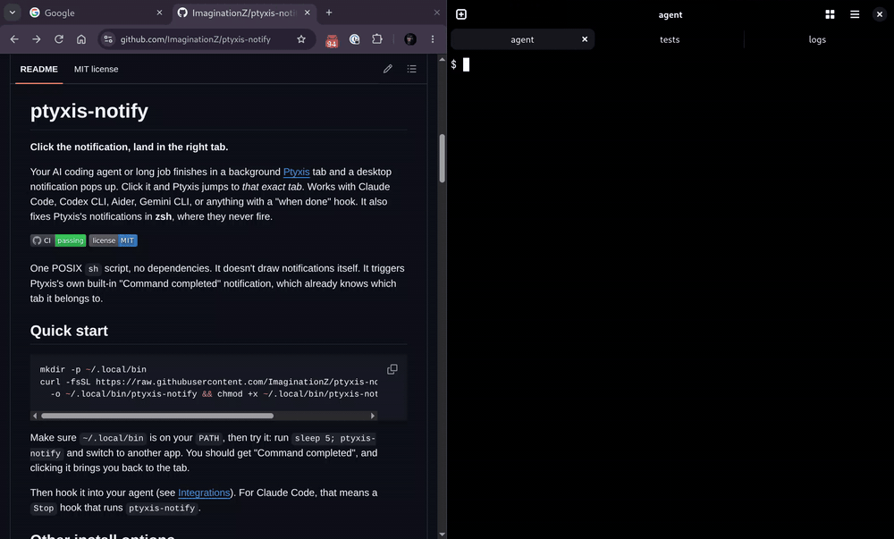

# ptyxis-notify

**Click the notification, land in the right tab.**

Your AI coding agent or long job finishes in a background
[Ptyxis](https://gitlab.gnome.org/chergert/ptyxis) tab and a desktop
notification pops up. Click it and Ptyxis jumps to *that exact tab*.
Works with Claude Code, Codex CLI, Aider, Gemini CLI, or anything with a
"when done" hook. It also fixes Ptyxis's notifications in **zsh**, where
they never fire.

[](https://github.com/ImaginationZ/ptyxis-notify/actions/workflows/ci.yml)
[](LICENSE)



One POSIX `sh` script, no dependencies. It doesn't draw notifications
itself. It triggers Ptyxis's own built-in "Command completed" notification,
which already knows which tab it belongs to.

## Quick start

```sh
mkdir -p ~/.local/bin
curl -fsSL https://raw.githubusercontent.com/ImaginationZ/ptyxis-notify/main/ptyxis-notify \
  -o ~/.local/bin/ptyxis-notify && chmod +x ~/.local/bin/ptyxis-notify
```

Make sure `~/.local/bin` is on your `PATH`, then try it: run
`sleep 5; ptyxis-notify` and switch to another app. You should get
"Command completed", and clicking it brings you back to the tab.

Then hook it into your agent (see [Integrations](#integrations)). For
Claude Code, that means a `Stop` hook that runs `ptyxis-notify`.

## Other install options

**From git** (update with `git pull`):

```sh
git clone https://github.com/ImaginationZ/ptyxis-notify ~/.local/share/ptyxis-notify
mkdir -p ~/.local/bin
ln -s ~/.local/share/ptyxis-notify/ptyxis-notify ~/.local/bin/ptyxis-notify
```

**zsh fix**: add to `~/.zshrc`, either from the git checkout:

```sh
source ~/.local/share/ptyxis-notify/shell/ptyxis-notify.zsh
```

or through a plugin manager, since the repo is a standard zsh plugin
(`ptyxis-notify.plugin.zsh`). For antidote, add `ImaginationZ/ptyxis-notify`
to `~/.zsh_plugins.txt`. For oh-my-zsh, run

```sh
git clone https://github.com/ImaginationZ/ptyxis-notify \
  "${ZSH_CUSTOM:-$HOME/.oh-my-zsh/custom}/plugins/ptyxis-notify"
```

and add `ptyxis-notify` to `plugins=(...)` in `~/.zshrc`.

## Usage

```sh
ptyxis-notify               # notify now (the usual call from a hook)
ptyxis-notify run make -j8  # run a command, notify when it exits (keeps its status)
ptyxis-notify start         # mark "started" ...
ptyxis-notify done          # ... and "finished" (notifies only after a start)
ptyxis-notify --help
```

Extra arguments to `notify` are ignored, so tools that append event data
(like Codex's JSON) can call it directly. A hook doesn't need a terminal of
its own: the script finds the tab's terminal by walking up its parent
processes.

> **bash users:** Ptyxis already notifies when a *shell command* finishes if
> you load `/etc/profile.d/vte.sh` (`vte-2.91.sh` on Debian). You need
> `ptyxis-notify` for programs that keep running in the tab, like an agent
> waiting for your input, where the shell never sees anything finish.

## Integrations

### zsh

VTE's `vte.sh` sends the "command finished" signal for zsh but never
"command started" (bash gets both), so Ptyxis's notification **never fires
in zsh**. Sourcing `shell/ptyxis-notify.zsh` adds the missing signal. It
also loads `vte.sh` if your zshrc doesn't already, which marks prompts with
OSC 133 and reports the working directory. From then on, any command that
finishes while you're in another app notifies you, with no wrapper needed.

### Claude Code

Merge [`examples/claude-code/settings.json`](examples/claude-code/settings.json)
into `~/.claude/settings.json`:

```json
{
  "hooks": {
    "Stop": [
      { "hooks": [{ "type": "command", "command": "ptyxis-notify", "timeout": 10 }] }
    ],
    "Notification": [
      {
        "matcher": "permission_prompt|elicitation_dialog",
        "hooks": [{ "type": "command", "command": "ptyxis-notify", "timeout": 10 }]
      }
    ],
    "PreToolUse": [
      {
        "matcher": "AskUserQuestion|ExitPlanMode",
        "hooks": [{ "type": "command", "command": "ptyxis-notify", "timeout": 10 }]
      }
    ]
  }
}
```

This notifies you when Claude finishes a turn, waits on a permission prompt
or MCP input form, asks you a question, or presents a plan. Claude Code picks up
settings edits automatically. Check `/hooks` to confirm, and restart the
session if the hooks don't appear.

### Codex CLI

`~/.codex/config.toml`:

```toml
notify = ["ptyxis-notify", "notify"]
```

### Aider (untested)

```sh
aider --notifications --notifications-command ptyxis-notify
```

Or set `notifications: true` and `notifications-command: ptyxis-notify` in
`~/.aider.conf.yml`. Aider runs the command only while notifications are on.

### Gemini CLI (untested)

`~/.gemini/settings.json` (Gemini's `timeout` is in milliseconds):

```json
{
  "hooks": {
    "AfterAgent": [
      { "hooks": [{ "type": "command", "command": "ptyxis-notify", "timeout": 5000 }] }
    ]
  }
}
```

### Anything else

Any tool with an "on done" or "on event" hook can run `ptyxis-notify`. In
shells without VTE integration, such as fish, use `ptyxis-notify run CMD...`.
PRs with tested snippets for other tools are welcome.

## What to expect

| Where you are when it fires | What happens |
| :- | :- |
| Another app (browser, editor, ...) | Desktop notification **"Command completed"**; clicking it focuses the tab |
| Same Ptyxis window, another tab | No popup; the tab gets an attention indicator |
| That same tab | Nothing |

- The text comes from Ptyxis: the title is "Command completed" (in your
  language) and the body is the tab's foreground command, such as
  `claude`. It can't be customized.
- The notification is withdrawn when you visit the tab.

## How it works

`notify-send`, `gdbus` and OSC 9/777 notifications can't focus a Ptyxis
tab. Ptyxis doesn't tell programs which tab they're in, and there's no
public "focus this tab" action to call.

Ptyxis does have a built-in notification whose click action
(`app.focus-tab-by-uuid`) targets the right tab. It fires when the terminal
receives VTE's shell-integration signals `vte.shell.preexec` (command
started) and then `vte.shell.precmd` (command finished), sent as OSC 666
sequences, while the window is unfocused (see
[`ptyxis-tab-notify.h`](https://gitlab.gnome.org/chergert/ptyxis/-/blob/48.5/src/ptyxis-tab-notify.h)).
`ptyxis-notify` sends those two signals on demand, with a short pause
between them (`PTYXIS_NOTIFY_DELAY`). The pause is needed because Ptyxis
looks up the tab's command after "started" and skips the notification if
"finished" arrives first. Ptyxis 50 and later also ignore anything shorter
than 250 ms, whether from `notify`, `run` or `start`/`done`.

Hooks usually have no terminal of their own, so the script writes each
~25-byte sequence to the tab's terminal device in a single write, and VTE
consumes it without displaying anything. Claude Code's race-free
`terminalSequence` hook output would be cleaner, but its allowlist doesn't
include OSC 666 yet.

## Troubleshooting

Nothing shows up? Run `PTYXIS_NOTIFY_DEBUG=1 ptyxis-notify` from the same
place and check:

1. **Notifications allowed?** Settings → Notifications → Ptyxis is on, and
   Do Not Disturb is off.
2. **Is the Ptyxis window focused?** Popups appear only when it isn't;
   otherwise you get the tab indicator.
3. **tmux / screen?** They swallow the sequences. Run the program directly
   in a Ptyxis tab.
4. **Hook loaded?** Check that the agent picked up its config (in Claude
   Code, `/hooks`), and restart the session if not.
5. **Environment:** the script sends nothing unless `VTE_VERSION` or
   `PTYXIS_VERSION` is set. Both can be lost under `sudo`, `ssh`, or hook
   runners that clean the environment. Set `PTYXIS_NOTIFY_FORCE=1` to
   override.
6. **Wrong terminal?** Point it at the tab explicitly, for example
   `export PTYXIS_NOTIFY_TTY=$(tty)` before starting the agent.

## Limitations

- **Ptyxis only.** Other VTE terminals (GNOME Terminal, Console, Tilix, ...)
  silently accept the sequences but don't notify. GNOME Terminal's similar
  feature was a Fedora-only patch and is gone. In non-VTE terminals the
  script sends nothing.
- **No tmux / screen.**
- **One process, one tab.** The script notifies the tab its process tree
  started in. A daemon or editor launched from tab A will always notify
  tab A.
- **SSH (untested):** the sequences pass through SSH, but `VTE_VERSION`
  usually isn't forwarded, so set `PTYXIS_NOTIFY_FORCE=1` on the remote
  host.
- If the tab's output is paused (Ctrl-S), the write blocks until the hook's
  timeout.
- Tested with Ptyxis 48.5 (VTE 0.80.1) on Debian. Ptyxis 50.1 is checked
  against its source only; reports welcome.

## Configuration

| Variable | Default | Meaning |
| :- | :- | :- |
| `PTYXIS_NOTIFY_TTY` | auto | Terminal device to write to |
| `PTYXIS_NOTIFY_DELAY` | `0.5` | Seconds between "started" and "finished" for `notify`. Keep it above 0.25: Ptyxis 50+ ignores shorter commands |
| `PTYXIS_NOTIFY_FORCE` | unset | `1` sends even when no VTE terminal is detected |
| `PTYXIS_NOTIFY_DEBUG` | unset | `1` explains on stderr what it found and did |

## Contributing

Issues and PRs are welcome, especially tested snippets for other tools and
reports from other distros or Ptyxis versions. Include `ptyxis --version`,
your shell, and whether tmux is involved. Run `sh tests/run.sh` and
`shellcheck` before sending changes. [AGENTS.md](AGENTS.md) explains how the
project fits together and what to do if a Ptyxis or VTE update breaks it,
for humans and coding agents alike.

## License

[MIT](LICENSE)
